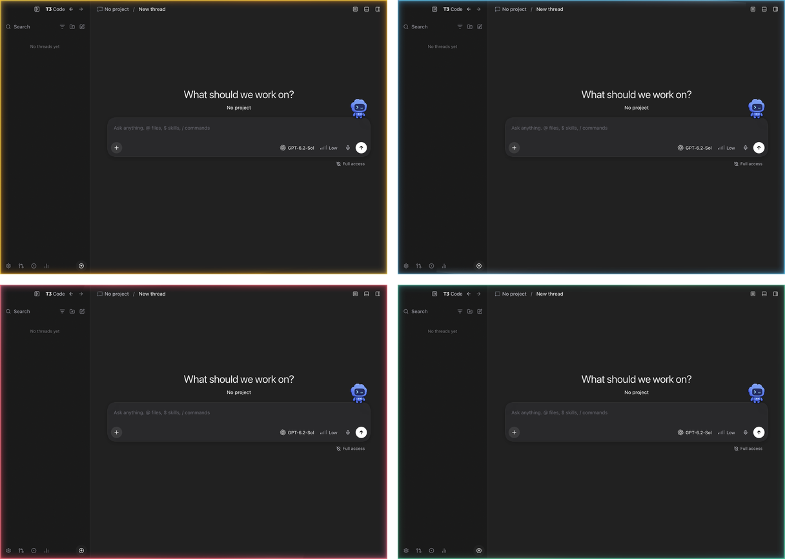

[简体中文](README.md) | **English**

# Edge glow

Lights up the window edge when an approval is needed, the agent is waiting for your answer, an error occurs, or a background run finishes.



An extension for [T3 Code Extensions](https://github.com/ZiHao256/t3code-extensions), an unofficial extension host for [T3 Code](https://github.com/pingdotgg/t3code). Install it in Settings → Extensions → Browse, or paste `https://github.com/ZiHao256/t3x-edge-glow` into the URL field there. "Check for updates" offers this repository's latest release, installed after you confirm.

## Install with an agent

Paste this to Claude Code, Codex or another coding agent:

```text
Install the T3 Code extension "Edge glow" (https://github.com/ZiHao256/t3x-edge-glow) on this Mac.
1. Check that T3 Code Extensions is installed. If it isn't, install it first by following the "Install with an agent" section of https://github.com/ZiHao256/t3code-extensions/blob/main/README.en.md, and ask me before quitting T3 Code.
2. Open ~/Applications/T3 Code Extensions.app, go to Settings → Extensions → Browse, and install "t3x-edge-glow" from the community list, or paste https://github.com/ZiHao256/t3x-edge-glow into the link field and click Add. In the confirmation dialog, check that the source is ZiHao256/t3x-edge-glow before confirming.
3. In the Installed tab, make sure it is enabled and tell me its version.
If you can't operate the app's UI, do step 1, then tell me exactly what to click for steps 2 and 3.
```

## Requirements

`apiVersion` 2: needs a T3 Code Extensions host that supports it. Older hosts refuse to install this version.

## Development

- `npm test` runs the tests (Node 22+, no dependencies).
- To try changes: Settings → Extensions → Add local extension, pick this folder, then click refresh on its card after each edit.

## Release

1. Change the code, bump `version` in `plugin.json`, run `npm test`, and commit.
2. Tag that commit `v<version>`, push it with the tag, and publish a GitHub release ("Check for updates" reads the latest release).

## License

MIT
